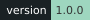
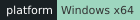
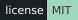
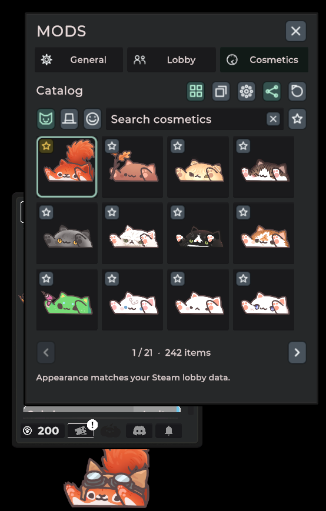
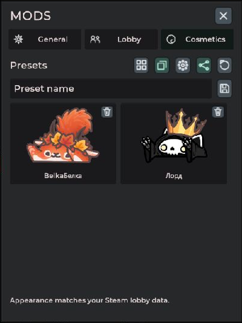
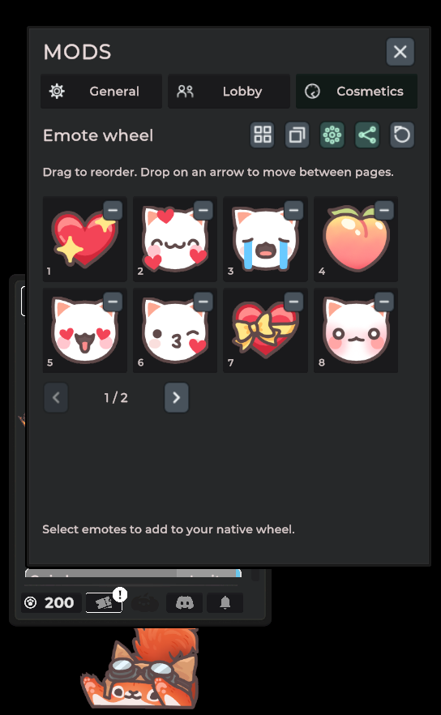
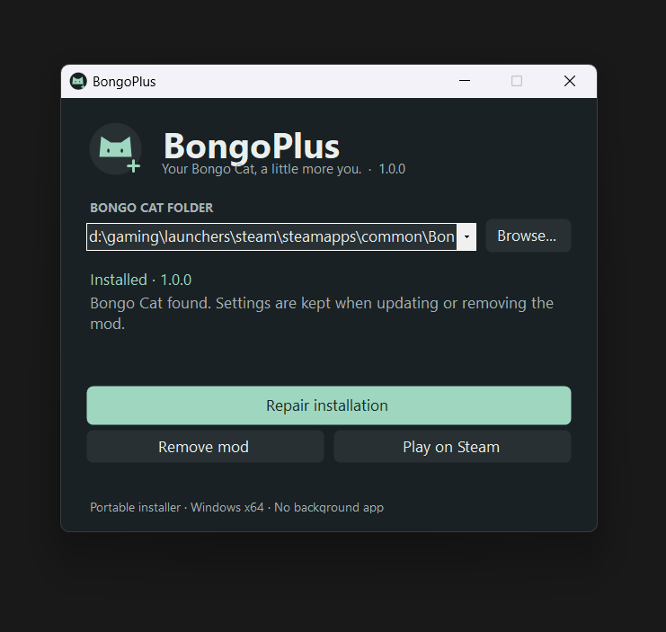

# BongoPlus

**Cosmetics, emotes, and chest automation for Bongo Cat.**

[Report an issue](https://github.com/lokalizator-repo/BongoPlus/issues)

## Make it yours

| Feature | What you get |
| --- | --- |
| **Cosmetics in your lobby** | Choose in-game skins and hats and share your appearance with other players. Your friends do not need BongoPlus. |
| **Saved looks** | Keep favorites close and save skin-and-hat presets with visual previews. |
| **A bigger emote wheel** | Add more than eight emotes, browse compact pages, and drag to arrange them in your preferred order. |
| **Chest automation** | Open your ready chests and gift ready chests to selected lobby members or everyone in the lobby. Choose cosmetic chests, emote chests, or both. |
| **Point controls** | View and change your available points within Steam's counter limits. |
| **A familiar interface** | Game-themed controls, saved preferences, and an optional keyboard shortcut. Everything runs inside Bongo Cat. |

## A closer look

  
  

## Install in three steps

1. Close Bongo Cat and open **BongoPlus.exe**, the portable installer distributed through GitHub Releases.
2. Click **Install BongoPlus**. It finds the game across your Steam libraries; use **Browse** if needed.
3. Launch Bongo Cat through Steam and open **Mods** in the game menu.

  

The EXE contains the plugin and loader. No separate SDK, Unity Editor, or background app is needed. Once installed, you can close or delete the installer.

**Requirements:** Steam's Windows x64 Mono version of Bongo Cat, Windows 10 or 11, and .NET Framework 4.7.2 or newer.

## Good to know

<strong>Where is the Mods button? Can I set a shortcut?</strong>

Open Bongo Cat's game menu; **Mods** sits along its upper edge. No shortcut is assigned by default. Set one in **General → Open Mods shortcut**. Click outside the mod window or press Escape to close it.

<strong>Will other players see my cosmetics?</strong>

Yes, when lobby appearance sharing is enabled. BongoPlus shares the IDs of standard in-game cosmetics through the game's lobby data. Other players do not need the mod, but their game must contain the corresponding assets. Custom image files are not transmitted, and selecting cosmetics does not add items to Steam Inventory.

<strong>Are point changes unlimited? Who pays for gifts?</strong>

Steam's historical point counters only increase. Available points are the difference between earned and spent points, so the maximum you can set depends on how much you have already spent. BongoPlus displays that limit; it cannot reset exhausted counters.

Gifts use your points. The recipient completes the game's normal item exchange. Sending a request or seeing a chest become unavailable does not prove that Steam has delivered the item.

<strong>How do updates and removal work?</strong>

Close the game and open a newer BongoPlus installer to update. **Remove mod** keeps your settings. The installer preserves shared loader files when other plugins use them and refuses to silently replace an unknown loader or modified installation files.

Settings live in `BepInEx/config/local.bongocat.mods.cfg`. The older internal filename is kept so existing preferences continue to work.

<strong>What happens after a game update?</strong>

An unfamiliar game build is checked feature by feature. Incompatible features are disabled with an explanation under **General → Compatibility details**. New cosmetics come from the game's current catalog.

Major API or engine changes can still require a BongoPlus update. The tested client uses Unity Mono `6000.2.8f1`, Steam build `25936063`.

## Help and development

Found a problem? [Open an issue](https://github.com/lokalizator-repo/BongoPlus/issues) with your BongoPlus version, what happened, and steps to reproduce it. If attaching `BepInEx/LogOutput.log`, remove Steam IDs, player names, or other personal information first.

For builds and tests, see **[BUILDING.md](BUILDING.md)**.

## License

BongoPlus code is available under the **[MIT license](LICENSE)**. Bundled dependencies retain their own licenses; see **[third-party notices](THIRD_PARTY_NOTICES.md)**.

BongoPlus is an independent project and is not affiliated with the developers of Bongo Cat, Valve, or Unity.
