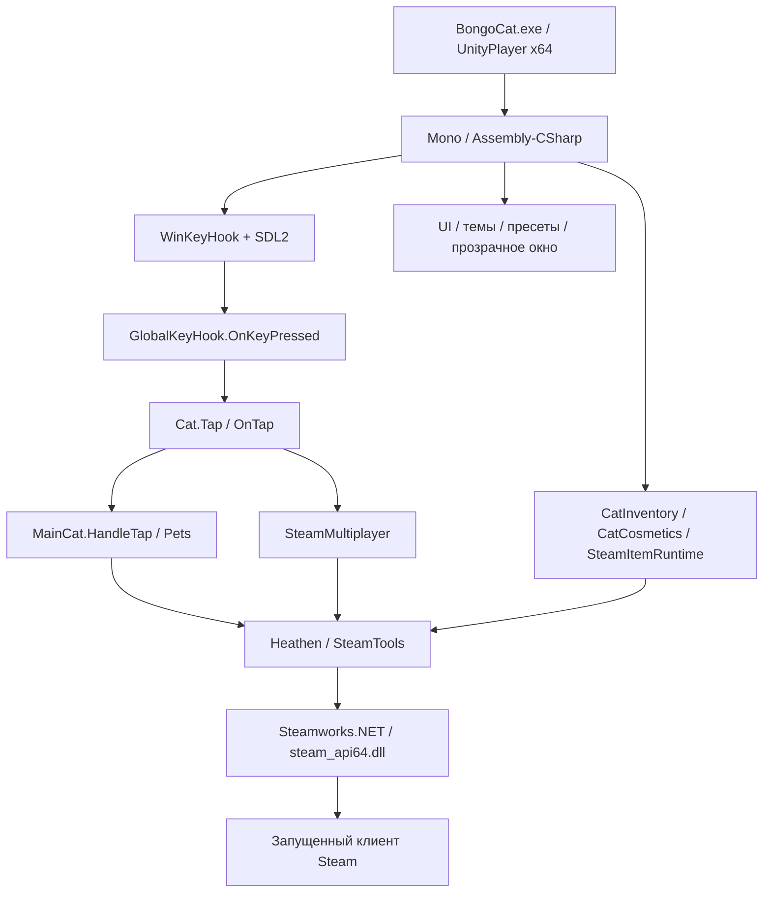

# Bongo Cat: архитектура Steam-клиента

Дата исследования: 2026-10-19. Цель — подготовить техническую основу для мода, работающего внутри установленной Steam-версии.

## Идентичность и границы анализа

| Параметр | Значение и источник |
|---|---|
| Установка | `D:\Gaming\Launchers\Steam\steamapps\common\BongoCat` |
| Steam App ID | `3419430`, appmanifest и `SteamTools.Game.Initialise` |
| Steam build ID | `25936063`, локальный appmanifest |
| Unity | `6000.2.8f1`, заголовок `globalgamemanagers`; версия UnityPlayer — `6000.2.8.13211946` |
| Процесс | Windows x64, PE machine `0x8664` в BongoCat.exe |
| Скриптовый backend | Unity Mono; REA определяет основную сборку как `unity-mono`, CIL, AnyCPU |
| Основная сборка | `BongoCat_Data/Managed/Assembly-CSharp.dll`, 485888 байт |
| SHA-256 | `96bbcbb2733988fd31ce261891eb3027888389e03b6a23dbd63e9e7f518adfb8` |
| MVID | `82e3b9ab-fca5-40ee-85ed-90fbe6e17162` |

REA прочитал 645 определений типов, 3500 методов, 3941 поле, 13003 статических ребра вызовов и 10272 обращения к полям основной сборки. Число типов включает вложенные классы и машины состояний. Декомпилятор ILSpy Engine `11.1.0.9782`, уже находившийся в локальном NuGet-кэше, восстановил 340 верхнеуровневых типов основной сборки, 268 типов Heathen.Steamworks и 23 типа Helper.Runtime, без ошибок выгрузки типов.

Метаданные и IL являются наблюдениями из поставленных файлов. Восстановленный C# — интерпретация декомпилятора, без доказательства эквивалентности и без проверки повторной компиляцией. Отсутствие ошибок выгрузки не доказывает правильность каждого выражения. REA отметил частичное покрытие пользовательских строк из-за несовпадений terminal flag в 22 строках #US; читаемый UTF-16 сохранён. Это замечание парсера не доказывает отказ Mono при исполнении.

Выполнен статический анализ. Не выполнялись запуск игры, подключение к процессу, установка загрузчика, изменение Steam-инвентаря или файлов установки. Не исследовались память процесса и сетевой трафик. Факт существования метода не доказывает, что соответствующий компонент включён в текущей сцене.

## Устройство приложения

Основные зависимости: Unity UI и TextMeshPro, DOTween, Newtonsoft.Json, Unity Localization/Addressables, Steamworks.NET, Heathen.Steamworks, SDL2, Discord SDK. Управление системным окном и опрос клавиатуры используют Win32 через P/Invoke. В основной сборке REA обнаружил 30 объявлений P/Invoke; это объявления импорта, а не отдельная проверка экспортов системных DLL.

## Запуск и готовность Steam

`Steam.InitHeathen.Awake` вызывает `SteamAPI.RestartAppIfNecessary`, затем `Events.Initialise` и `SteamTools.Game.Initialise`. Последний вызывает `App.Client.Initialise(3419430, ...)`; обработчик успешной инициализации передаёт управление `Interface.RaiseOnReady`. Готовность предоставляется через `SteamTools.Interface.IsReady` и `WhenReady`.

В сборке также есть `IroxGames.StoreFronts.Steam.SteamManager` с собственной инициализацией, callbacks и shutdown. Его присутствие не доказывает, что именно он обслуживает текущую сцену. Восстановленный getter `Instance` возвращает `null`; использовать его как надёжную точку интеграции без проверки нельзя.

Другие подсистемы ждут более узких условий: `Steam.StatsInitializer.Initialized`, `CatInventory.Instance.IsInitialized`, `MainScreenSetting.IsInitialized`. Плагину нужно ожидать нужные экземпляры и условия готовности. Повторно инициализировать Steam API из мода не требуется.

Источники: `Steam.InitHeathen.cs`, `SteamTools.Game.cs`, `IroxGames.StoreFronts.Steam.SteamManager.cs`; в каталоге Heathen — `SteamTools.Interface.cs`, `Heathen.SteamworksIntegration.API.App.cs`.

## Ввод, анимация и счётчики

`GlobalKeyHook.WinKeyHook.ProcessInput(bool)` опрашивает `GetAsyncKeyState` для набора виртуальных клавиш, хранит предыдущее состояние и возвращает количество новых нажатий. Есть исключение кнопок мыши по настройке. Несмотря на имя, этот класс использует опрос, а не `SetWindowsHookEx`.

`BongoCat.OSSpecific.GlobalKeyHook` создаёт `System.Threading.Timer` с интервалом 16 мс. Фоновая обработка накапливает `_keysDown`; `Update` вызывает `OnKeyPressed(int)` в Unity-потоке. Поддержка контроллеров реализована через SDL2; для триггеров задан интервал 0,2 секунды. В текущем коде обмен `_keysDown` между Timer и Update не использует Interlocked: расширять эту часть без учёта потоков нежелательно.

`MainCat.Start` подписывает `Cat.Instance.Tap` на `OnKeyPressed`. `Cat.Tap(int)` сначала вызывает `OnTap`, затем чередует левую и правую анимацию. `MainCat.HandleTap` передаёт количество в `Pets.AddPet`. Следовательно, патч `Cat.Tap` затрагивает и визуал, и связанные события прогресса; для изменения только внешнего вида лучше выбирать методы отображения.

`Pets` загружает Steam-статистику `BongoTap`, `BongoBeat`, `BongoMinus`, хранит накопленные и потраченные значения, обновляет отображение и вызывает `StoreStats` каждые 60 секунд. Сложение ограничено сверху значением 2147483646. Отдельный `PawPassManager` управляет сезонным прогрессом и наградами. Какие UnityEvent-связи подключают его в конкретной сцене, без чтения сериализованных объектов не установлено.

`OnDemandRenderHelper` участвует в приостановке и возобновлении рендера при анимации. Новый анимированный UI должен учитывать этот механизм, иначе визуальные обновления могут не отрисовываться ожидаемым образом.

## Косметика и изображения

`SteamItemIdReference` — ScriptableObject с каталогом `AllItemData` и словарём `id → SteamItemRuntime`. `SteamItemBasic` содержит теги, описание, параметры магазина и свойства предмета. `SteamItemRuntime` связывает эти данные с Heathen `ItemData`, изображениями и состоянием интерфейса.

Слоты включают `hat`, `skin`, `bongos`, `emote`, `consumable`, `uitheme`. Владение определяется через `RuntimeData.GetTotalQuantity()`, а не флагом в локальном JSON.

`MemoryImageCache` строит словарь из сериализованного списка Unity Sprite. Имена изображений выводятся из имени предмета без пробелов:

- Иконка: `<Name>Icon`.
- Основное изображение: `<Name>`.
- Скин и бонго: `<Name>Left`, `<Name>LeftPunch`, `<Name>Right`, `<Name>RightPunch`.

`Cat.SetItem` маршрутизирует предмет в отображение шляпы, скина или бонго. Сам кот рисуется Unity UI Image. Подмена Sprite или lookup в `MemoryImageCache.GetSprite` — конкретные кандидаты для локальной кастомизации.

В `CatCosmetics` уже разделены настоящая экипировка `EquippedItems` и временное примеривание `_locallyEquippedItems`. При нулевом количестве предмета используется локальный режим; он не сохраняет владение и не публикует обычное обновление экипировки. `RestoreActuallyEquippedItems` восстанавливает внешний вид при закрытии соответствующей вкладки. Постоянная экипировка сохраняется под `EQUIPPED_ITEMS_3` и отражается в данных участника лобби.

Добавление собственного спрайта локально не обеспечивает его появление у других игроков: текущий протокол передаёт ID предмета, а не байты текстуры.

## Инвентарь, обмены и выдача

`CatInventory` создаёт UI по локальному каталогу и, после готовности Steam, запрашивает `Inventory.Client.GetAllItems` каждые 120 секунд. Через Heathen вызов доходит до `SteamInventory.GetAllItems`. Обновление проверяет EResult, пересчитывает UI и валидирует косметику, эмоции и тему.

Обмены проходят через `SteamExchange`, `ItemData.Exchange`, `Inventory.Client.ExchangeItems` и `SteamInventory.ExchangeItems`. Локальная схема содержит определения input/output, но принятие обмена устанавливается результатом Steam. Восстановление клиентской логики не восстанавливает конфигурацию Steam backend.

`PlaytimeItemDrop` содержит таймер в 60 секунд, проверку количества двух токенов и `TriggerItemDrop` с definition ID 10. `ItemDropHeartbeat` отдельно вызывает `SteamInventory.SendItemDropHeartbeat` каждые 60 секунд при готовности Steam. Наличие `ItemGenerator` в сборке не доказывает его использование в рабочей сцене или доступность произвольной выдачи. Эти пути не запускались.

Примечательная граница: `HandleInventoryUpdate` выставляет `IsInitialized` до раннего выхода при пустом результате, а `FetchingItems` сбрасывает позже. Плагину не стоит считать один флаг универсальным признаком полностью загруженного UI.

## Мультиплеер

`SteamMultiplayer` использует чат Steam Lobby. Сообщение сериализуется как JSON с полями `Channel` и `Message`; Heathen кодирует его UTF-8 и отправляет через механизм лобби. Значения косметики дополнительно живут в member data (`hat`, `skin`, `bongos`).

| Channel | Назначение | Payload Message |
|---:|---|---|
| 2 | Нажатия | Целое число в строке |
| 3 | Речь | Строка |
| 4 | Открытие сундука для участника | `<target SteamID>:<ChestType>` |
| 5 | Полученный предмет | Item definition ID в строке |
| 6 | Эмоция | Item definition ID в строке |
| 7 | Сброс leaderboard | `Reset` |
| 8 | Погладить участника | Target SteamID в строке |

`SendingTapsRoutine` проверяет накопленные нажатия раз в кадр. Положительные значения меньше 8 отправляются, значения от 8 сбрасываются без отправки. Это наблюдение текущего кода, а не установленный лимит Steam. Приём маршрутизируется в `Bus<T>` по SteamID отправителя.

Имеются отдельные классы создания/входа в лобби, приглашений, имён участников, видимости и размещения котов. `CatSpawnManager` и набор паттернов отвечают за расстановку. Обмен с немодифицированными клиентами потребует сохранения существующего формата; новый сетевой функционал потребует согласованного поведения участников.

## UI, настройки и системное окно

`UiThemeManager` управляет `Current`, `Previewed`, `ForceLegacy`, регистрацией `ThemedComponent` и массовым обновлением `PushAll`. `UiTheme`, `UiThemeSet` и роли цвета/спрайта/шрифта образуют встроенную систему тем. Это удобная точка расширения интерфейса; прямые изменения отдельных Image могут быть перезаписаны применением темы.

`PlayerPrefsToggle.Value` сохраняет настройку, обновляет UI и вызывает `OnToggleUpdated`. Ключи многих переключателей сериализованы в сцене в `_playerPrefsKey`: по одному имени поля нельзя надёжно вывести ключ реестра.

`TransparentWindow.Update` определяет click-through через UI raycast, видимость курсора и GamingMode. `WinTransparentWindow` использует DWM с резервным color-key режимом, управляет `WS_EX_TRANSPARENT`, `WS_EX_LAYERED`, `WS_EX_TOOLWINDOW`, topmost и границами монитора. До загрузки сцены несколько runtime-init методов временно перемещают окно за экран. Эти механизмы влияют на новое меню мода: корректный raycast и настройка прозрачности нужны для кликов по нему.

## Сохранения и IPC

Подтверждённые ключи: `EQUIPPED_ITEMS_3`, `UI_THEME`, `PRESETS`, `Favorite_<id>`, `Hidden_<id>`, `BongoMenuPosXRel`, `BongoMenuPosYRel`. `Helper.PlayerPrefsHelp` сериализует объекты; `PresetManager` объединяет локальные пресеты и `presets.json` из Steam Cloud, устраняя дубликаты по тройке Hat/Skin/Bongos ID. `SteamCloudHelper` использует UTF-8 JSON и `SteamRemoteStorage`.

`TapTapLootIntegration.Ipc` содержит две интеграции Windows named pipes: сервер `TapTapLootxBongoCat`, передающий JSON баффов, и клиент `BongoCatxTheFarmerWasReplaced`, принимающий количества нажатий. Протокол обрамления находится в `StreamString`. Это узкие межигровые интеграции, универсального mod API из них не следует. Подключение к каналам и отправка данных не выполнялись.

В имени одного метода GlobalKeyHook обнаружен текст, предлагающий ввести код в игре ради предмета. Он рассмотрен только как данные исследуемого приложения; указанное действие не выполнялось.

## Практическая стратегия мода

По устройству этой сборки разумный кандидат — загружаемый C#-плагин внутри оригинального Unity Mono процесса с точечными runtime-патчами. Это инженерный вывод из доступного CIL и структуры классов; рабочий mod loader на этой установке ещё не проверен.

Официальная документация [BepInEx для Unity Mono](https://docs.bepinex.dev/master/articles/user_guide/installation/unity_mono.html) описывает Windows x64 вариант загрузчика. [Harmony](https://harmony.pardeike.net/v2/articles/patching) предоставляет Prefix/Postfix и другие runtime-патчи. Эти источники подтверждают назначение инструментов, но не совместимость конкретной сборки загрузчика с Bongo Cat на Unity 6000.2.8f1. Версию следует фиксировать после отдельного smoke-теста.

| Задача | Точки для исследования/расширения |
|---|---|
| Собственное меню | MenuTabs, MenuWindow, SettingsManager, Unity UI |
| Собственная тема | UiThemeManager, UiTheme, ThemedComponent |
| Локальные изображения | MemoryImageCache.GetSprite, Cat.SetItem и методы отображения |
| Реакции на настоящий ввод | GlobalKeyHook.OnKeyPressed, Cat.OnTap |
| Сортировка и фильтры | CatInventory.SortItems/SortCollections, InventoryQualityFilter |
| Пресеты | PresetManager и PresetsWindow с учётом записи в Cloud |
| Позиции и прозрачность | MainCat, Draggable, TransparentWindow, WinTransparentWindow |
| Размещение участников | Multiplayer.Spawning.CatSpawnManager и паттерны |

Первый технический этап: загрузчик + минимальный диагностический плагин, который пишет в лог версии и готовность экземпляров, затем показывает небольшую локальную панель. Это позволит проверить Mono-патчинг, порядок инициализации, клики и рендер при запуске через Steam до разработки большого клиента.

Для устойчивости к обновлениям следует связывать патчи с именем типа и полной сигнатурой, проверять ожидаемую сборку и отключать несовместимый модуль с понятным логом. Токены из METHODS.md нужны для этого исследования, но не подходят как постоянные идентификаторы после обновления.

## Что остаётся проверить

| Вопрос | Состояние |
|---|---|
| Backend, архитектура, версии, основная CIL-логика | Установлено статически |
| Цепочки ввода, отображения, инвентаря, Cloud, форматы лобби | Прослежены по коду и статическим вызовам |
| Содержимое спрайтов, префабов, ScriptableObject и связи UnityEvent | Файлы учтены; типизированное извлечение ещё не выполнено |
| Какие компоненты реально активны в level0 | Требуется анализ сериализованной сцены или наблюдение процесса |
| Полная бизнес-конфигурация Steam backend | Недоступна из клиентской сборки |
| Работа выбранного mod loader на этой версии | Не проверена |
| Отрисовка, click-through, DPI, несколько мониторов с модом | Требуется реальный запуск |
| Загрузка/выгрузка, перезапуск через Steam, работа после обновлений | Требует smoke-тестов |

## Доказательства и навигация

- `raw/install-manifest.json`: SHA-256 и размеры 202 файлов установки; позволяет обнаружить смену версии.
- `raw/rea-evidence.json`: полный экспорт REA, 41 запись. Повторные страницы — представления того же сохранённого анализа.
- Основные Evidence: artifact `ev_58496a4aa024df51446198137ae207fe13bda9c41287c4fcd3276734f040a090`; members `ev_4d755a9152816e7104c7b14f49ffc8e80cbd38b715d48abd9016845a1e7f12bb`; native declarations `ev_65baed022948e92a049f4c624d85212ba1c5d83408bbd63b1ef6a8cb5022ca24`.
- [METHODS.md](METHODS.md): точные токены методов выбранных подсистем, привязанные к SHA-256/MVID.
- `decompiled/Assembly-CSharp/`: игровая логика; имена файлов — полные имена типов.
- `decompiled/Heathen.Steamworks/`: SteamTools и реализация обёрток Steam API.
- `decompiled/Helper.Runtime/`: вспомогательные компоненты.

Полное восстановление Unity-проекта и рабочий мод не являются результатом этого этапа. Получены проверяемая статическая карта клиента, локальная C#-реконструкция и конкретные точки для следующего этапа разработки.
